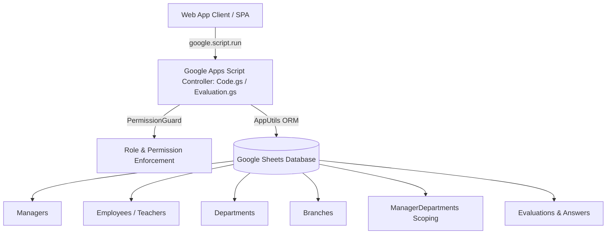
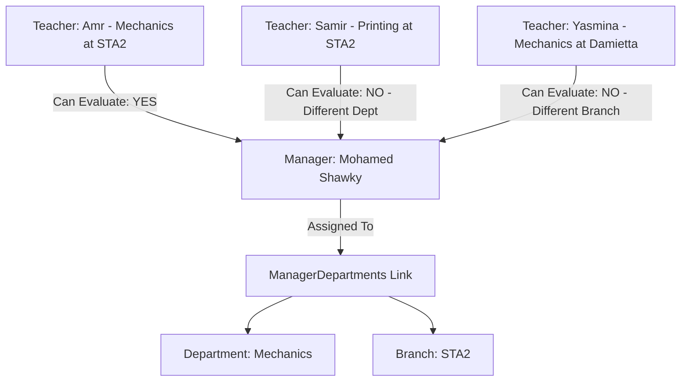
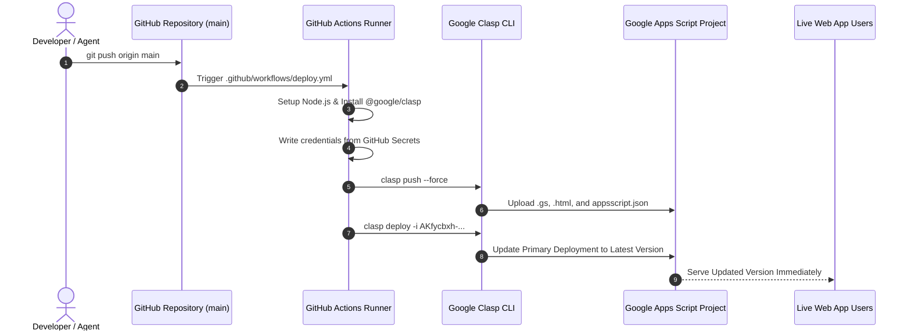

# STA Instructor Evaluation System — Complete Technical & Deployment Manual
**Elsewedy Technical Academy (STA) — أكاديمية السويدي التقنية**

---

## 1. Executive Summary & Architecture

The **STA Instructor Evaluation System** is an enterprise-grade academic observation, survey, and analytics platform built for the Elsewedy Technical Academy. It enables academic supervisors and department managers to perform classroom evaluations of instructors, aggregates performance across 6 core academic domains, enforces strict departmental scoping per school branch, and provides interactive analytics with exportable PDF reports.

### Tech Stack
- **Backend & API**: Google Apps Script (V8 Runtime)
- **Database**: Google Sheets (Normalized relational tables accessed via AppUtils ORM/cache layer)
- **Frontend**: Single-Page Application (SPA) served via `HtmlService`, styled with Tailwind-inspired custom CSS & FontAwesome icons
- **CI/CD & DevOps**: Google Clasp (`@google/clasp`), GitHub Actions, Git

---

## 2. Database Schema & Relationships

The database is hosted on Google Spreadsheet ID: `1X2Vuyxkm0eoYevjXQT52bWiA_tXri16hzXSBkY3FOCU`.

### 2.1 Table Specifications

| Sheet Name | Primary Key | Key Columns | Description |
| :--- | :--- | :--- | :--- |
| **`Managers`** | `manager_id` | `name`, `email`, `role`, `status`, `created_at` | Administrative & Managerial user accounts |
| **`Employees`** | `employee_id` | `name`, `email`, `department_id`, `branch_id`, `school_branch`, `position`, `status` | Teachers and academic staff |
| **`Departments`** | `department_id` | `department_name`, `status`, `created_at` | Academic departments (e.g. Arabic, Mechanics) |
| **`Branches`** | `branch_id` | `branch_name`, `status`, `created_at` | School locations (STA1, STA2, Zohr, etc.) |
| **`BranchDepartments`** | `branch_dept_id` | `branch_id`, `department_id`, `status` | Junction table linking departments to branches |
| **`ManagerDepartments`** | `mgr_dept_id` | `manager_id`, `department_id`, `branch_id`, `status`, `created_at` | **Scoping Table:** Links managers to specific departments in specific branches |
| **`Classes`** | `class_id` | `name`, `grade`, `department_id`, `status` | Classrooms and student sections |
| **`Questions`** | `question_id` | `question_text`, `category`, `weight`, `status` | Evaluation criteria questions |
| **`Evaluations`** | `evaluation_id` | `manager_email`, `teacher_id`, `teacher_name`, `school`, `grade`, `class_name`, `avg_score`, `submitted_at` | Header record for each observation |
| **`EvaluationAnswers`** | `answer_id` | `evaluation_id`, `question_id`, `rating`, `weight`, `weighted_score` | Individual criteria scores (scale 1 to 5) |

---

## 3. Manager Department Scoping (Access Control)

### The Problem Solved
Previously, any manager could view and evaluate any teacher across all schools. 

### The Solution: Triple-Key Scoping
The scoping is enforced through the junction record:
$$\text{Scoping Key} = (\text{manager\_id}, \text{department\_id}, \text{branch\_id})$$

- **Enforcement Layer**: [`getTeachersForCurrentManager()`](file:///E:/WORK/FreeLance/STAManagerSurvey/STAManagerSurvey/STAManagerSurvey/code.gs) inspects the caller's active email session, loads their assigned department/branch pairs from `ManagerDepartments`, and filters the teacher dropdown.
- **Super Admin Bypass**: Accounts with `ROLE_SUPER_ADMIN` or `ADMIN` retain full authority to evaluate all teachers across all branches.

---

## 4. Key Functional Modules

### 4.1 Performance Dashboard & Analytics
- **KPI Overview**: Real-time evaluation counts, general average score with radial percentage indicator, active questions, and distinct instructors evaluated.
- **Dynamic Month Filter (تصفية حسب الشهر)**:
  - Dynamically detects every month present in the `Evaluations` records.
  - Automatically recalculates all KPI cards, category radar averages, branch comparisons, department ranks, and recent submissions.
- **Teacher Drill-down**: Select a branch, department, and teacher to view their granular category performance with radar visualization.
- **High-Fidelity PDF Export**: Client-rendered print-optimized vector PDF reports including filters and category matrices.

### 4.2 Administrative Modules
- **Manager-Department Linking (`ربط المديرين بالاقسام والفروع`)**:
  - Interactive manager cards displaying scoped teacher counts.
  - Multi-branch assignment builder.
  - Secure deletion using HTML5 data attributes (`data-mgr-dept-id`, `data-mgr-id`, etc.) immune to apostrophe syntax errors.
- **Classroom Management (`إدارة الفصول`)**: Full CRUD support for classes with grade levels.
- **Branch Management (`إدارة الفروع`)**: Add, edit, and link departments per school branch.
- **Question & Weight Configuration**: Customize evaluation domains and weighting multipliers.

---

## 5. CI/CD & Deployment Architecture

Automated deployment is configured using **Google Clasp** and **GitHub Actions**. Every commit pushed to the `main` branch is tested and published directly to Google Apps Script.

### 5.1 Deployment Credentials & Secrets
In your GitHub Repository (**Settings → Secrets and variables → Actions**):
- **`SCRIPT_ID`**: `1KZ6YuM9Hty09nSqOfUAA9jW-dg2Sa3ZMc0Rhqb_M0KXm6xppy4efR_en`
- **`CLASPRC_JSON`**: Contents of `~/.clasprc.json` (Google OAuth refresh token).

### 5.2 Primary Live URLs
- **Primary Production Web App**:
  [https://script.google.com/macros/s/AKfycbxh-fZpL4u5Wu0lY6-v1gwkp6BbhIxyYAYRxf23raJq-82gpf8PCiRbCifrqnpjGY1K/exec](https://script.google.com/macros/s/AKfycbxh-fZpL4u5Wu0lY6-v1gwkp6BbhIxyYAYRxf23raJq-82gpf8PCiRbCifrqnpjGY1K/exec)
- **Development / Zero-Cache URL**:
  [https://script.google.com/macros/s/AKfycbzQNH26sku71nrXLFlZ4xSK_vbruNZ_T1L2f5VHQRc/dev](https://script.google.com/macros/s/AKfycbzQNH26sku71nrXLFlZ4xSK_vbruNZ_T1L2f5VHQRc/dev)

---

## 6. Developer Guidelines & Best Practices

1. **Global Scope in Google Apps Script**:
   - In GAS, all `.gs` files share the exact same global namespace.
   - **Never** declare duplicate top-level `const` or `let` variables with the same name across different `.gs` files (e.g. `SOURCE_SPREADSHEET_ID`), as it causes fatal compile-time syntax errors. Use namespaced objects or `var`.
2. **HTML Attribute Escaping**:
   - When generating inline HTML buttons with strings that might contain single quotes or apostrophes (e.g., `Students' Development`), do not pass raw strings inside `onclick="func('...')"` handlers.
   - Always bind arguments using HTML5 dataset attributes: `data-dept-name="..."` and read them with `element.getAttribute()`.
3. **Browser Cache Busting**:
   - Google Apps Script iframes are cached heavily by modern browsers. Always instruct users to perform a **Hard Refresh (`Ctrl + Shift + R`)** when verifying newly deployed changes.
